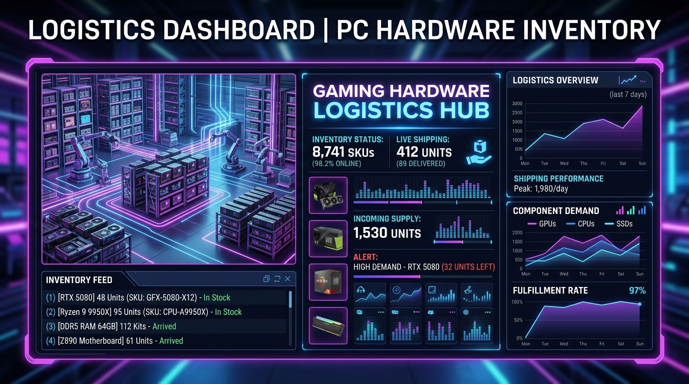
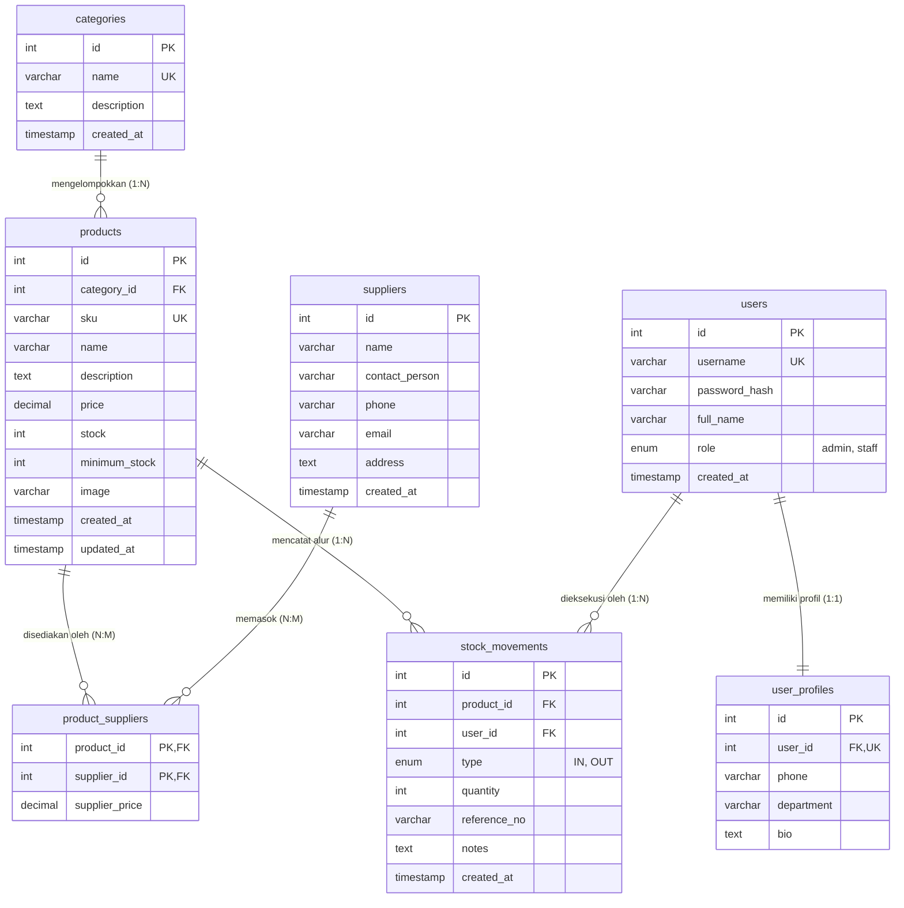
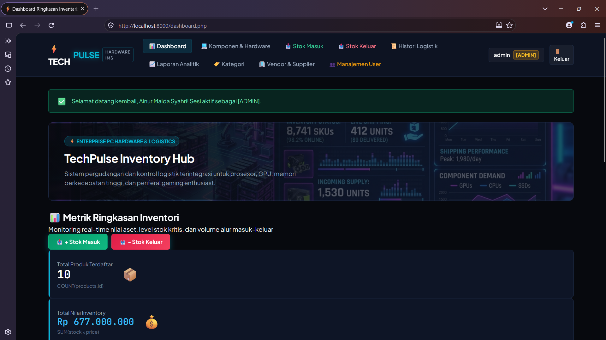
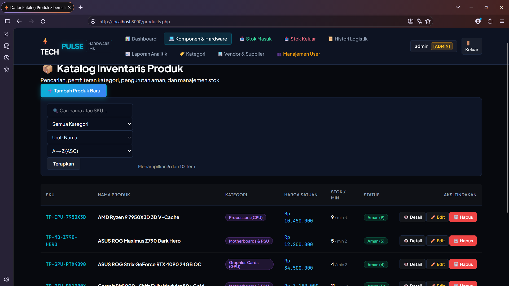
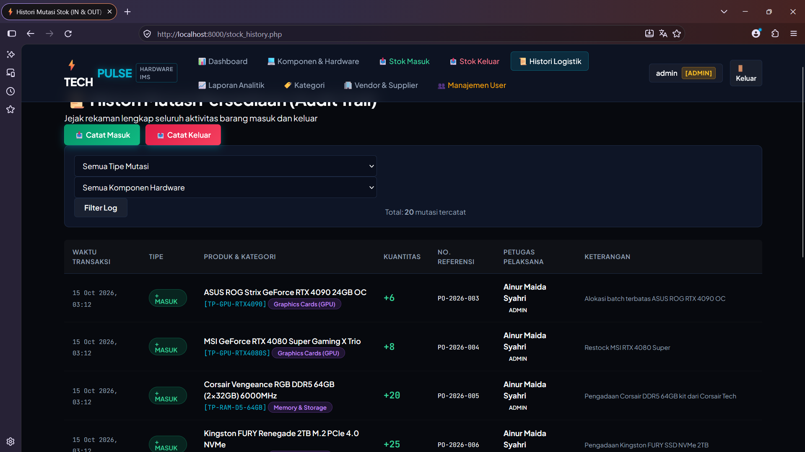

# ⚡ TechPulse IMS — PC Hardware & Gaming Gear Logistics Management System
**Mini Project 3 (Pertemuan 4): Relational Database & Advanced PHP Native (PDO, RBAC, Transactions)**



---

## 📌 Identitas Pengembang
- **Nama Pengembang:** Ainur Maida Syahri
- **Mata Kuliah:** Pemrograman Berbasis Web / Framework Terapan
- **Topik Mini Project:** Pertemuan 4 — Relational Database + Advanced PHP Native
- **Basis Data:** MySQL / MariaDB (`inventory_techpulse_p4`)
- **Teknologi:** PHP 8.1+, MySQL 10.4+, PDO Drivers, HTML5 / CSS3 Grid & Flexbox, JavaScript ES6

---

## 🚀 Ringkasan Sistem (Executive Summary)
**TechPulse IMS** adalah platform manajemen logistik dan pergudangan terintegrasi khusus untuk distributor komponen *High-Performance PC Hardware* & *Gaming Gear* (seperti prosesor generasi mutakhir, kartu grafis ray-tracing, modul RAM DDR5, motherboard kelas atas, SSD NVMe ultra-cepat, dan monitor kompetitif).

Sistem ini dirancang dengan mematuhi prinsip rekayasa perangkat lunak modern:
1. **Desain Basis Data Relasional Normalisasi Penuh** dengan implementasi 3 tipe relasi utama:
   - **One-to-One (1:1):** Relasi tabel `users` ke `user_profiles` dengan cascading constraints.
   - **One-to-Many (1:N):** Relasi tabel `categories` ke `products`, serta `products`/`users` ke `stock_movements`.
   - **Many-to-Many (N:M):** Relasi tabel `products` dan `suppliers` melalui tabel junction `product_suppliers` dengan atribut tambahan `supplier_price`.
2. **Keamanan Berlapis (Enterprise Security Architecture):**
   - **PDO Prepared Statements:** Menghapus celah *SQL Injection* secara menyeluruh pada semua parameter input dinamis.
   - **Role-Based Access Control (RBAC):** Pemisahan hak akses berbasis sesi antara pengguna bertipe `admin` (akses kontrol penuh & manajemen user) dan `staff` (operator pergudangan).
   - **Data Validation & Sanitization:** Validasi *syntactic* dan *semantic* sisi server sebelum query dijalankan.
   - **Output Escaping:** Sanitasi seluruh data output menggunakan `htmlspecialchars(..., ENT_QUOTES, 'UTF-8')` untuk mitigasi serangan *Cross-Site Scripting (XSS)*.
   - **Password Security:** Hashing kredensial menggunakan algoritma standar industri `PASSWORD_BCRYPT`.
3. **Integritas Data Transaksional Atomik (ACID):**
   - Mekanisme transaksi `beginTransaction()`, `commit()`, dan `rollBack()` pada modul pencatatan barang masuk (*Stock In*) dan barang keluar (*Stock Out*) untuk menjamin konsistensi stok fisik dan log pergerakan.

---

## 📊 Arsitektur Relasi Basis Data (ERD Diagram)



---

## 🔑 Akun Pengujian Demo (Test Credentials)

| Role | Username | Password | Deskripsi Hak Akses |
| :--- | :--- | :--- | :--- |
| **Admin** | `admin` | `admin123` | Akses penuh: Manajemen Produk, Kategori, Supplier, Mutasi Stok, Laporan Agregat, serta Manajemen User (RBAC Master). |
| **Staff** | `staff` | `staff123` | Operator gudang: Melihat katalog, melakukan transaksi Stok Masuk & Stok Keluar, serta melihat riwayat logistik. Dibatasi dari menu Master User. |

---

## 🛠️ Panduan Instalasi & Menjalankan Proyek

### 1. Prasyarat Sistem
- **XAMPP / Laragon** dengan Apache & MariaDB / MySQL aktif.
- **PHP 8.0 atau lebih baru** dengan ekstensi `pdo_mysql` aktif.

### 2. Impor Skema Basis Data
Buka **phpMyAdmin** (`http://localhost/phpmyadmin`) atau gunakan command-line client:
1. Buat database `inventory_techpulse_p4` (atau langsung jalankan skema otomatis):
   ```sql
   source /path/ke/Mini_projectmaida3/database/schema.sql;
   ```
2. Seluruh tabel relasional, foreign keys, serta 10 data produk hardware awal, 5 supplier resmi (ASUS ROG, MSI, Corsair, Gigabyte AORUS, Kingston FURY), dan 2 akun pengguna akan otomatis terisi.

### 3. Konfigurasi Koneksi Database
Periksa file `config/database.php`:
```php
define('DB_HOST', '127.0.0.1');
define('DB_PORT', '3306');
define('DB_NAME', 'inventory_techpulse_p4');
define('DB_USER', 'root');
define('DB_PASS', '');
```

### 4. Menjalankan Server Lokal
Cukup jalankan script batch otomatis atau terminal:
- **Cara 1 (Windows Batch):** Klik ganda pada file `run_local.bat`.
- **Cara 2 (Terminal):**
  ```bash
  cd Mini_projectmaida3
  php -S localhost:8000
  ```
Buka peramban web pada alamat: **`http://localhost:8000`**

---

## 📂 Struktur Direktori Proyek

```
Mini_projectmaida3/
├── assets/
│   ├── css/
│   │   └── style.css            # Desain kustom modern, cyber-hardware dark theme
│   ├── images/
│   │   └── banner.jpg           # Aset visual banner hardware resolusi tinggi
│   └── banner.jpg
├── config/
│   └── database.php             # Koneksi PDO singleton dengan penanganan error PDOException
├── database/
│   └── schema.sql               # Skrip DDL & DML lengkap (7 tabel relasional + seed data)
├── helpers/
│   ├── auth.php                 # Helper autentikasi sesi dan otorisasi RBAC (is_admin, require_login)
│   ├── escape.php               # Helper sanitasi XSS (e()) dan format mata uang Rupiah
│   └── validation.php           # Helper validasi server-side (allowlist sort, SKU unik, positive int)
├── views/
│   ├── alert.php                # Komponen notifikasi flash dinamis (success, danger, warning)
│   ├── footer.php               # Komponen footer global dengan attribution Ainur Maida Syahri
│   ├── header.php               # Komponen header global, meta tags, dan import stylesheet
│   └── navbar.php               # Navigasi utama adaptif berbasis role (Admin vs Staff)
├── categories.php               # CRUD master data kategori hardware (1:N)
├── dashboard.php                # Metrik analitik agregat (COUNT, SUM inventory value, alert stok kritis)
├── forbidden.php                # Halaman penolakan akses 403 Forbidden untuk proteksi RBAC
├── index.php                    # Redirector cerdas ke dashboard atau login
├── login.php                    # Form autentikasi dengan tombol quick-fill demo
├── logout.php                   # Penghancur sesi terenkripsi
├── product_create.php           # Formulir tambah produk hardware + multi-supplier selection (N:M)
├── product_delete.php           # Handler hapus produk dengan pengecekan integritas relasional
├── product_detail.php           # Rincian spesifikasi produk, vendor pemasok, dan histori mutasi
├── product_edit.php             # Formulir edit produk hardware dan relasi supplier
├── products.php                 # Katalog produk dengan live search, filter kategori, dan multi-sort
├── reports.php                  # Laporan analitik agregat dan rekap alur logistik
├── run_local.bat                # Eksekutor instan PHP built-in web server
├── stock_history.php            # Audit trail histori keluar/masuk barang dengan pagination/filter
├── stock_in.php                 # Modul transaksi barang masuk berbasis DB Transactions
├── stock_out.php                # Modul transaksi barang keluar dengan validasi batas stok fisik
├── suppliers.php                # CRUD master data distributor/vendor dan junction price
├── users.php                    # Modul manajemen akun dan profil pengguna khusus Administrator (1:1)
└── README.md                    # Dokumentasi komprehensif proyek
```

---

## 📸 Dokumentasi & Hasil Pengujian Sistem

| 1. Pusat Komando Dashboard & Metrik | 2. Katalog Komponen Hardware |
| :---: | :---: |
|  |  |

| 3. Transaksi Mutasi Stok (ACID Transaction) |
| :---: |
|  |

---

## 🛡️ Rincian Fitur & Poin Penilaian Mini Project 4

1. **Relational Database Design (Bobot Maksimal):**
   - Mengimplementasikan skema normalisasi pihak ketiga (3NF).
   - Menghubungkan relasi 1:1 (`users` & `user_profiles`), 1:N (`categories` & `products`), dan N:M (`products` & `suppliers` via `product_suppliers`).
   - Foreign key dengan constraint `ON DELETE CASCADE` atau `ON DELETE RESTRICT` sesuai peruntukan bisnis.
2. **PDO & Prepared Statements:**
   - 100% query parametrik menggunakan named placeholder `:param` atau positional placeholder `?`.
   - Mengeliminasi kerentanan SQL Injection.
3. **Database Transactions (ACID):**
   - Transaksi mutasi stok menjalankan `beginTransaction()`, manipulasi stok `UPDATE products`, pembuatan log `INSERT INTO stock_movements`, dan ditutup dengan `commit()` jika sukses atau `rollBack()` saat terjadi galat.
4. **Role-Based Access Control (RBAC):**
   - Halaman `users.php` diproteksi fungsi `require_admin()`. Jika staf non-admin mengakses secara sengaja melalui manipulasi URL, sistem mengembalikan status HTTP `403 Forbidden` dan menampilkan halaman peringatan keamanan `forbidden.php`.
5. **UI & Desain Berkelas:**
   - Palet warna bernuansa **TechPulse Hardware** (*Deep Slate, Neon Cyan, Indigo, Violet*).
   - Tipografi modern Google Font (*Plus Jakarta Sans* & *JetBrains Mono*).
   - Responsif di perangkat desktop, tablet, maupun layar seluler.

---
**TechPulse IMS** &bull; Dibuat dengan dedikasi oleh **Ainur Maida Syahri**.
